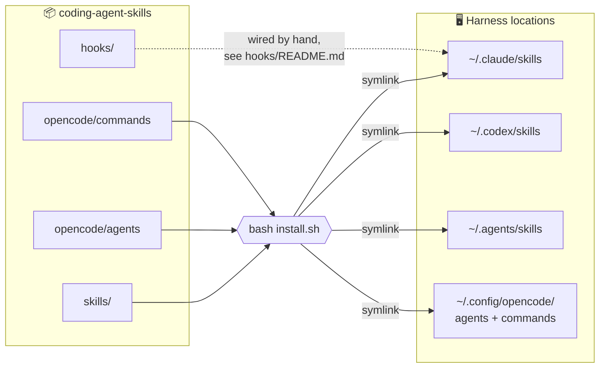
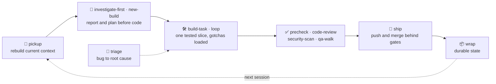
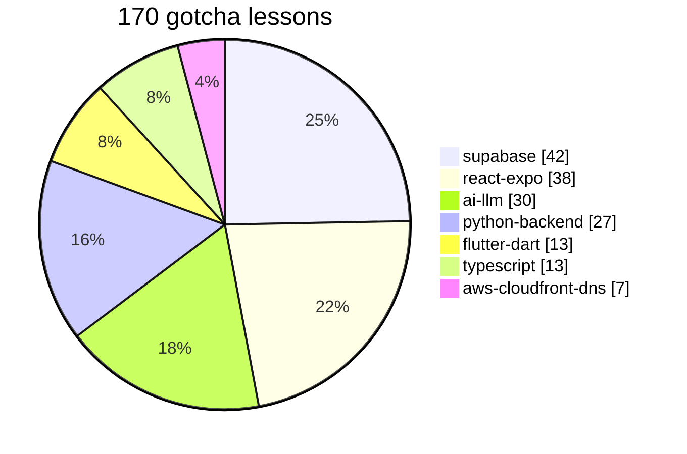
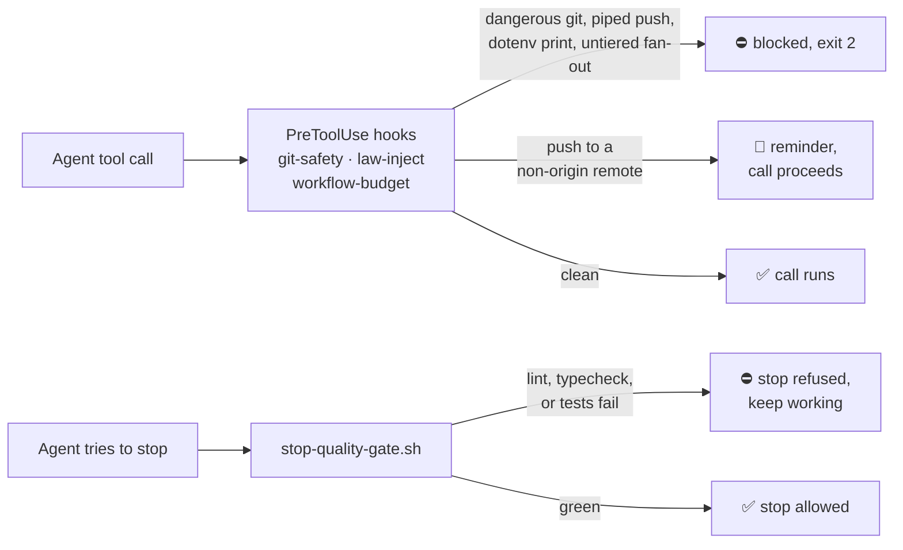

<div align="center">

# coding-agent-skills

**One skill library for Claude Code, Codex, and OpenCode.**

A shared library of skills, guardrail hooks, handoff commands, and reviewer prompts for coding agents.
A harness here means Claude Code, Codex, or OpenCode. Install once and each harness on the machine reads the same lessons, review gates, and session handoffs.


</div>

---

## Contents

- [What it does](#what-it-does)
- [Where it is today](#where-it-is-today)
- [How it fits together](#how-it-fits-together)
- [Skill catalog](#skill-catalog)
- [Guardrail hooks](#guardrail-hooks)
- [Quick start](#quick-start)
- [Commands](#commands)
- [Repository tour](#repository-tour)
- [Quality and testing](#quality-and-testing)
- [Security](#security)
- [Contributing](#contributing)
- [License](#license)

## What it does

1. **Install one library into four harness locations** - `install.sh` symlinks every skill into Claude Code, Codex, and the shared skill directory, and symlinks the OpenCode agents and commands into the OpenCode config directory.
2. **Load the gotchas before writing code** - seven stack gotcha skills carry 170 lessons, each one a bug that already cost a real debugging cycle.
3. **Build in small, tested slices** - new-build, build-task, loop, triage, ship, and the rest of the build loop take an idea to a merged pull request one slice at a time, with tests written first and a stop at every push, merge, and deploy.
4. **Review before you ship** - precheck, code-review, security-scan, qa-walk, and route-walk turn "it looks done" into a gated verdict.
5. **Hand work between sessions and agents** - pickup and wrap keep project state durable across harnesses.
6. **Catch the expensive mistakes** - four hooks refuse dangerous git commands, a piped `git push`, printing a dotenv file, an untiered agent fan-out, and a stop while lint or tests are failing.

## Where it is today

*Status snapshot: November 9, 2026*

| Area | What it covers | Status |
|------|----------------|--------|
| Skills | 26 skill directories, each with a `SKILL.md` | ✅ Shipped in the tree |
| Gotcha lessons | 170 lessons across seven stacks | ✅ Shipped in the tree |
| Hooks | 4 guardrail hooks with 35 test cases | ✅ Tests pass locally |
| Commands and prompts | 4 commands, 14 agent prompt files, 3 rules files, 3 qa-walk templates | ✅ Shipped in the tree |
| Public release | Install, use, and license | ✅ Ready to install from this repository |

**Current focus**

- **Install and use** - clone this repository, run `bash install.sh`, and wire the hooks from [`hooks/README.md`](hooks/README.md).

## How it fits together

### Install topology



Everything is a symlink, so a `git pull` in this repository updates every harness at once. The installer skips any destination that already exists and is not a symlink, and it never copies hooks or a settings file.

### A session, start to finish



## Skill catalog

| Group | Skill | When it loads |
|-------|-------|---------------|
| **Stack gotchas** | `react-expo-gotchas` | React, Expo, Expo Router, NativeWind, EAS, Next.js, Vercel |
| | `supabase-gotchas` | PostgREST, RLS, edge functions, GoTrue, storage |
| | `python-backend-gotchas` | uv, Pydantic v2, Typer, FastAPI, httpx, Stripe webhooks |
| | `ai-llm-gotchas` | Model selection, model ids, extraction limits, RAG trust boundaries |
| | `flutter-dart-gotchas` | google-services wiring, flavors, analyze scope, iOS white screens |
| | `typescript-gotchas` | tsc verification, Vitest, ESM imports, built-but-not-wired props |
| | `aws-cloudfront-dns-gotchas` | CloudFront certs and aliases, registrar-held domains, DNS cutovers, ECS and Cloud Functions rollouts |
| **Build loop** | `new-build` | Turn an idea into a one-page brief and a plan of small slices |
| | `build-task` | Build exactly one slice, tests first, then commit and stop |
| | `loop` | Run plan, build, review, and ship as one loop, stopping at every go |
| | `triage` | Take a bug report to a root cause, a failing test, and a fix |
| | `ship` | Push, open a pull request, and merge only after its own checks |
| | `code-audit` | Read the whole repo and rank what could hurt users before launch |
| | `figma-parity` | Compare a built screen with its Figma frame and list the differences |
| | `build-rules` | The quality rules every build-loop skill follows |
| **Review and QA** | `precheck` | Before pushing: Codex review of staged, uncommitted, and recent commits |
| | `code-review` | Pre-ship audit before store submission or handoff |
| | `security-scan` | Whole-repo security gate against the app's own threat model |
| | `qa-walk` | Goal-driven end-to-end walk of every user workflow |
| | `route-walk` | Enumerates every distinct user path into a CSV route map |
| **Process** | `investigate-first` | Investigate and report before any code generation |
| | `write-tech-spec` | A code-grounded implementation spec for one ticket |
| | `git-for-agents` | Worktrees, atomic commits, and push safety when an agent runs git |
| | `observation-masking` | Keep tool output from filling the context window |
| **Continuity** | `pickup` | Resume a project from remote-current state |
| | `wrap` | Package a session into durable project state and a handover |

`precheck` and `code-review` run the [Codex CLI](https://github.com/openai/codex) as the reviewer, so install and sign in to Codex before using them. `figma-parity` needs the Figma MCP server.

### Gotcha lessons by stack



## Guardrail hooks



| Hook | Event | What it does |
|------|-------|--------------|
| `pre-tool-git-safety.sh` | PreToolUse `Bash` | Blocks dangerous git commands, a pipe after `git push`, and `git worktree prune` without `--dry-run` |
| `pre-tool-law-inject.sh` | PreToolUse `Bash` | Blocks `tail`, `cat`, and `head` of a dotenv file; nudges on a push to a remote other than `origin` |
| `pre-tool-workflow-budget.sh` | PreToolUse `Workflow` | Blocks an untiered agent fan-out (Python, run with `python3`) |
| `stop-quality-gate.sh` | Stop | Runs lint, typecheck, and tests for a Python or Node project and blocks the stop when they fail |

Wiring examples live in [`hooks/README.md`](hooks/README.md). The ten standing laws the hooks enforce are in [`rules/ring0-laws.md`](rules/ring0-laws.md); laws 4, 7, and 8 are reminders, not blocks.

## Quick start

### Prerequisites

- bash and git
- Python 3, for the fan-out hook and the security-scan tests
- [uv](https://docs.astral.sh/uv/), for the qa-walk helper tests
- shellcheck, for the shell lint

No environment file is required.

### Install

```bash
git clone git@github.com:22atlas-Studio/coding-agent-skills.git
cd coding-agent-skills
bash install.sh
```

### Run

There is no server to start. After install, Claude Code, Codex, and OpenCode read the linked skills and OpenCode files. To turn on the guards, point the harness at the scripts in `hooks/` using [`hooks/README.md`](hooks/README.md). Do not copy a private settings file, and do not turn on a permissions bypass.

Confirm the git-safety hook with:

```bash
bash hooks/tests/test-git-push-pipe-guard.sh
```

## Commands

Run each command from the repository root and inspect its exit code.

| Command | Purpose |
|---|---|
| `bash install.sh` | Link skills and OpenCode files into the four harness locations |
| `bash hooks/tests/test-git-push-pipe-guard.sh` | Run the 27 git-safety hook cases |
| `bash hooks/tests/test-law-inject.sh` | Run the 8 law-injector cases |
| `python3 -m pytest skills/security-scan/tests` | Run the 20 security-scan tests |
| `(cd skills/qa-walk/helpers && uv run pytest tests)` | Run the 28 qa-walk helper tests (uv installs the helper dependencies) |

<details>
<summary><b>Shell lint</b></summary>

```bash
shellcheck -x install.sh hooks/pre-tool-git-safety.sh hooks/pre-tool-law-inject.sh \
  hooks/stop-quality-gate.sh hooks/tests/test-git-push-pipe-guard.sh \
  hooks/tests/test-law-inject.sh skills/qa-walk/runners/codex.sh
```

`pre-tool-workflow-budget.sh` is Python, so it is not in the shellcheck command. There is no typecheck gate, build, or release script in this repository.

</details>

## Repository tour

| Path | What it is |
|------|------------|
| `skills/` | 26 skill directories, each with a `SKILL.md` |
| `agents/` | 9 Claude reviewer prompt files, loaded by path ([why no frontmatter](agents/README.md)) |
| `commands/` | 2 Claude handoff commands: pickup and wrap |
| `opencode/` | 5 OpenCode agents and 2 OpenCode commands |
| `hooks/` | 4 guardrail hooks and their tests |
| `rules/` | Standing laws, delegation rules, and review security rules |
| `install.sh` | Symlink installer |
| `LICENSE` | MIT license |

| Rules file | Purpose |
|---|---|
| [`rules/ring0-laws.md`](rules/ring0-laws.md) | Ten standing laws. Laws 4, 7, and 8 are nudges. |
| [`rules/agents.md`](rules/agents.md) | When to delegate work to a reviewer or subagent. |
| [`rules/security.md`](rules/security.md) | Ownership checks and untrusted-input rules for review. |

## Quality and testing

- **83 automated tests** across the hooks (27 + 8) and two skill helper suites (20 + 28).
- **Every gate runs on its own** so each exit code is visible; a piped command hides the code that matters.
- **Verified means exercised** against the real system or data, never inferred from a reading of the diff.

This repository has no web UI. A passing hook test does not prove a live agent session. The manual check is that `bash install.sh` creates the symlinks and that a harness can see the linked skills.

## Security

- **No secrets in the tree** - nothing in skills, hooks, commands, or prompts should contain a credential.
- **Dotenv files stay unprinted** - the law injector blocks `tail`, `cat`, and `head` on a dotenv file. Do not weaken that check.
- **No user data** - this library does not authenticate users or store customer data. Do not add tokens, account identifiers, or private paths.
- **Reporting** - raise security concerns through a private GitHub security advisory on this repository.

## Skills from other authors

These skills are good and we use them alongside this library. They are not copied here; install them from their authors:

| Skill | Author | Where |
|---|---|---|
| `tdd`, `write-a-prd`, `prd-to-plan`, `prd-to-issues`, `triage-issue`, `write-a-skill` | Matt Pocock | [mattpocock/skills](https://github.com/mattpocock/skills) (some have since been renamed or reorganized there) |
| `baseline-ui` | ibelick | [ibelick/ui-skills](https://github.com/ibelick/ui-skills) |
| `github-deep-review` | Peter Steinberger | [steipete/agent-scripts](https://github.com/steipete/agent-scripts) |
| `webapp-testing` | Anthropic | [anthropics/skills](https://github.com/anthropics/skills) |

## Contributing

Use a focused branch, preserve unrelated work, and run the commands in the [Commands](#commands) section. Record each exit code in the pull request. Do not describe a change as verified from a reading of the diff alone.

## License

This repository is released under the MIT License. See [LICENSE](LICENSE).

---

<div align="center">

Built by **Sean Weldon** at **22atlas**

</div>
